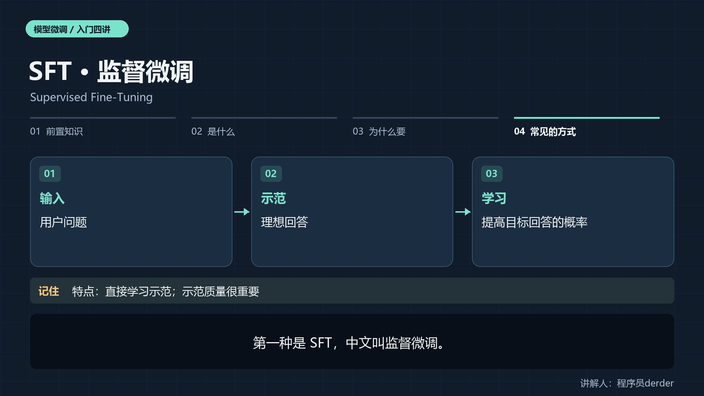
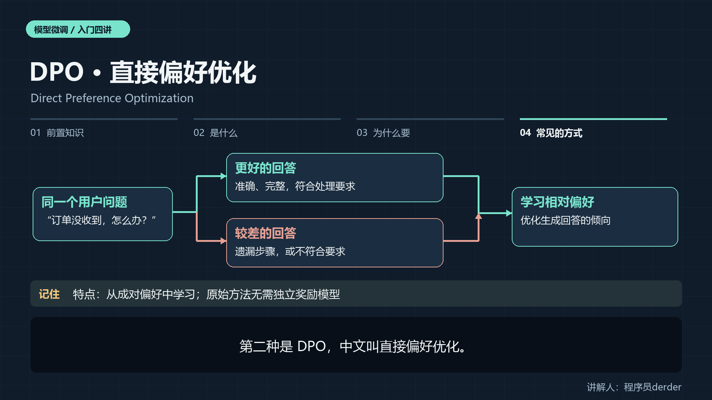
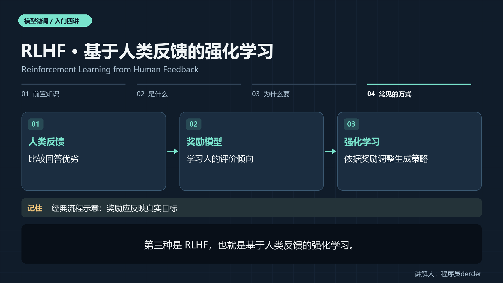
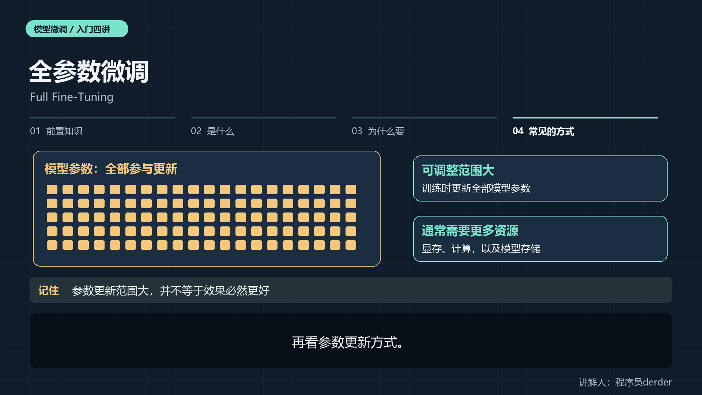
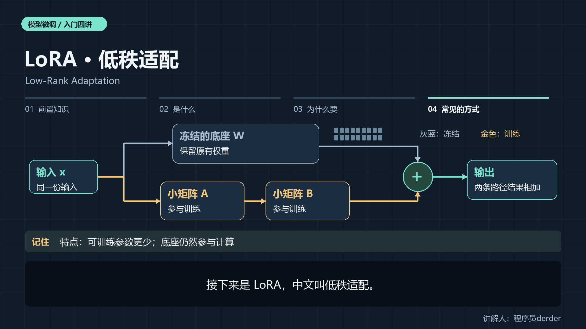
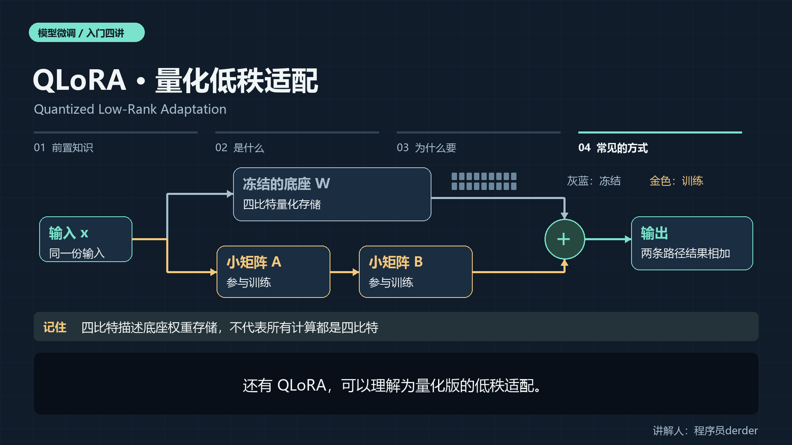

# 模型微调：新手入门图解

大家好，我是程序员derder。这次我们聊聊模型微调的入门知识。

本文先补齐基础前置知识，再解释微调是什么、为什么要微调，最后用图解认识几种常见方法。

你不需要先懂复杂公式，跟着看完就能对模型微调建立基本概念。 

## 1.前置知识

**1.1 模型参数**

模型参数，是参与计算的大量数值。

输入的文字会被分词器转换成词元，也叫 Token，再映射为数字编号。

注意：一个词元不一定就是一个汉字或一个单词。 

**1.2** **训练与推理**

训练时，模型**根据数据计算损失**，再利用**梯度调整可训练参数**。

>  损失可以理解为训练目标下的一种**误差度量**。
>
> 梯度可以理解为帮助确定参数调整的方向。

推理时，模型使用已有参数生成回答。

**1.3 数据分工**

数据也要分工，分为训练集，验证集，测试集。

训练集用于学习，验证集帮助调参和选择模型，测试集用于最后评估。

其中如果训练集和测试集重复，成绩就可能虚高，只在训练样本上表现好、遇到新问题就失灵，是过拟合的典型表现。 

## 2.模型微调是什么

模型微调是什么？简单说，就是从已有模型出发，用特定任务或领域的数据继续训练，使它更适合你的用途。可以把它类比成给已有基础的人做专项训练。这个类比不代表模型像人一样理解知识，也不代表所有参数都必须修改。 

例如，希望客服助手按统一步骤回答问题，可以准备“用户问题”和“理想回答”的示范。

训练后，再用没见过的问题检查它是否学会。

模型不是把这些问答当成数据库逐条存取，而是通过参数更新改变生成回答的倾向。

微调也有边界，微调不保证模型永远正确，也不保证它记住每一条事实。

专项训练后的效果，需要在具体任务上验证，不能只凭几段漂亮回答下结论。

拿到微调模型，也仍然要检查错误案例和适用范围。

## 3.为什么要模型微调

模型微调常见目标是让模型更稳定地遵循输出格式、保持表达风格，或适应分类、信息抽取等任务。

简单来讲就是让模型拥有特定领域的能力，比如：法律知识，表达风格等等。

对客服助手来说，我们希望同类问题有一致的处理方式。

这是训练目标，能否实现仍要靠评测。

**3.1什么时候使用模型微调？**

从提示词、检索，还是微调中来看：

先判断问题来源。要求没说清，可以先改提示词；

需要最新产品信息或可追溯依据，可以考虑检索增强，也叫 RAG：先找资料，再交给模型生成答案；

长期重复的行为要求，再考虑微调。

**这是选型思路，不是绝对规则，三者可以组合。** 

**3.2用同一把尺子比较**

实践中，先明确成功标准，并测出现有模型的基线。比如客服回答是否准确、步骤是否完整。微调后，用相同标准比较，还要记录训练与运行成本。

训练损失下降，只说明更贴合训练目标，不等于实际业务一定更好。 

>  基线可以理解为微调前，模型在同一套评测任务上的表现。

## 4.常见的模型微调方式

常见方法，先分清两条轴：**训练目标（怎么学习） × 参数更新方式**

比如监督微调描述训练目标，低秩适配描述参数更新方式。

下面逐个看它们是什么、有什么特点。 

**第一轴：训练目标（怎么学习）**

### 4.1 SFT · 监督微调

Supervised Fine-Tuning
第一种是 SFT，中文叫监督微调。它让模型学习问题和理想回答的示范。比如客服回答先确认订单，再给处理步骤。它的特点是目标直观，适合训练回答方式和格式，但示范有错，模型也可能学到错误模式。 

### 4.2 DPO · 直接偏好优化

Direct Preference Optimization
第二种是 DPO，中文叫直接偏好优化。对同一个问题，准备更好和较差的回答，让模型学习相对偏好。它的特点是利用比较信息来优化行为，这里的偏好必须可靠，不能只凭回答长短打分。

### 4.3 RLHF · 基于人类反馈的强化学习

Reinforcement Learning from Human Feedback

第三种是 RLHF，也就是基于人类反馈的强化学习。

经典流程先用人类偏好训练奖励模型，再用奖励指导语言模型改进回答。它的特点是把评价信号用于优化策略，但流程更复杂，奖励设计不当时，模型可能只学会迎合评分。 

总结：训练目标（怎么学习），目前相对主流的方式是DPO，成本较RLHF低，效果也比较好。

**第二轴：参数更新方式。**

### 4.4 全参数微调

Full Fine-Tuning
再看参数更新方式。全参数微调，就是训练时更新模型的全部参数。它的特点是可调整范围大，但通常需要更多显存、计算和存储资源。是否值得采用，要结合任务效果与资源预算判断。

### 4.5 LoRA · 低秩适配

Low-Rank Adaptation
接下来是 LoRA，中文叫低秩适配。看这张图：原有的大矩阵W 保持冻结，旁边增加两个可训练的小矩阵，用它们表示权重的改变量。它属于参数高效微调，特点是可训练参数更少，便于保存不同任务的适配器。注意，冻结底座不等于底座不参与计算，也不保证效果总与全参数微调相同。

**LoRA 图解**

灰蓝色表示冻结的原有权重，金色表示本次训练会更新的参数。同一输入既通过原有权重计算，也通过两个新增小矩阵计算；两条路径的结果相加。图中省略缩放系数、具体层位置等实现细节，展示核心计算关系。“冻结”表示不更新这部分权重，不表示它停止参与前向或相关梯度计算。适配器需要与对应底座及配置搭配使用。

### 4.6 QLoRA · 量化低秩适配

Quantized Low-Rank Adaptation
还有 QLoRA，可以理解为量化版的低秩适配。它把冻结的底座权重以四比特形式存储，再训练 LoRA 参数。它的特点是进一步减少显存需求，但四比特不代表全部训练计算都用四比特，具体效果仍要评估。 

以下为术语与图解速查，便于课后复习。这里把学习目标和参数更新方式分开，避免将可组合的方法误当成互斥选项。

| 名称 | 英文全称 | 是什么 | 主要特点 |
|---|---|---|---|
| SFT：监督微调 | Supervised Fine-Tuning | 通过高质量示范训练模型的回答方式 | 目标直观；数据质量影响学习结果 |
| DPO：直接偏好优化 | Direct Preference Optimization | 使用同一问题下更好与较差的回答学习相对偏好 | 原始方法无需单独训练奖励模型；偏好质量重要 |
| RLHF：基于人类反馈的强化学习 | Reinforcement Learning from Human Feedback | 利用人类反馈形成奖励信号，再以强化学习优化策略 | 经典流程包含奖励模型，流程较复杂；需要关注奖励设计 |
| 全参数微调 | Full Fine-Tuning | 更新全部模型参数 | 可调整范围大；通常需要更多训练资源 |
| LoRA：低秩适配 | Low-Rank Adaptation | 冻结原有权重，训练表示权重增量的小矩阵 | 可训练参数更少，可保存任务适配器 |
| QLoRA：量化低秩适配 | Quantized Low-Rank Adaptation | 量化冻结底座权重，再训练 LoRA 参数 | 进一步节省显存；四比特存储不等于所有计算都为四比特 |

另两个基础术语：

- **PEFT，Parameter-Efficient Fine-Tuning，参数高效微调**：只训练少量参数的适配方法类别；LoRA 属于这一类别。
- **RAG，Retrieval-Augmented Generation，检索增强生成**：将检索得到的外部资料提供给生成模型，以辅助回答。

## 5.最后

最后，把方法放回实际需求。

先判断问题来源。要求没说清，可以先改提示词；

需要最新产品信息或可追溯依据，可以考虑检索增强，也叫 RAG：先找资料，再交给模型生成答案；

长期重复的行为要求，再考虑微调。

这是选型思路，不是绝对规则，三者可以组合。 

模型微调时先建立基线，再选择训练方式

有示范，就考虑监督微调；

有可靠偏好，再考虑偏好优化；

资源有限，可以评估低秩适配或量化方案。

先明确目标、准备数据、建立基线，再看独立评测结果。

模型微调不是强制规则，没有任何能对微调后的模型的成本下降、能力提升或幻觉消失作保证。

我是程序员derder，我们下次见。 
